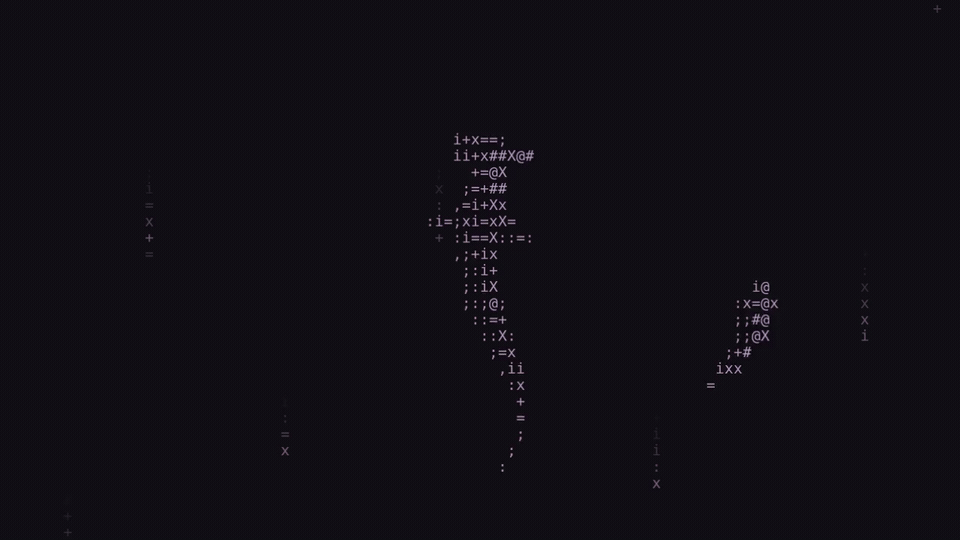
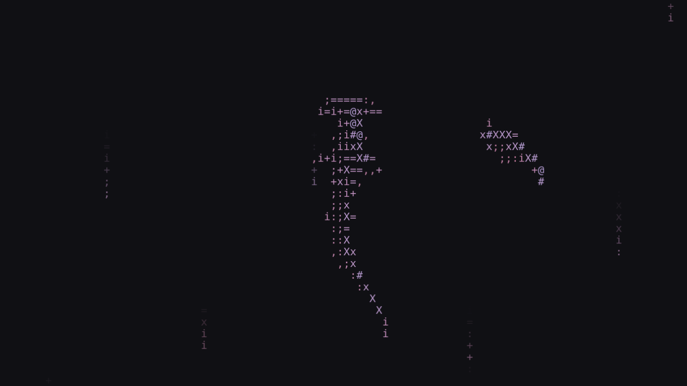
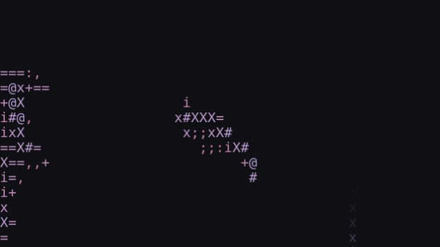

# asciipaper-hyprland

An animated ASCII shark wallpaper for Hyprland, with sparse Matrix rain and a pink cursor fish that swims forward through turns. The articulated tail follows its previous path, while fixed screen-right lighting gives the fish a pink/mauve volume gradient.



[Watch the full MP4 demo](docs/media/demo.mp4) · [Configuration](docs/configuration.md) · [Licenses and credits](THIRD_PARTY_NOTICES.md)

The fish tracks the global Hyprland pointer, so it remains visible behind translucent windows. Your normal cursor is hidden only while it is over the wallpaper; application cursors are unchanged.

## Scope

- Linux with Hyprland; locally exercised on Ubuntu 25.10 and Hyprland 0.55.4.
- Global pointer tracking requires **exactly one active, unrotated output**. Multi-monitor layouts and rotated outputs are unsupported.
- This is a standalone add-on around the unchanged [asciipaper engine](https://github.com/cYoren/asciipaper-engine), not a compositor plugin. It does not use `hyprpm`.
- Stop your existing wallpaper service manually before starting this one. The installer does not edit Hyprland configuration, stop other wallpapers, or start services.




## Build and install

You need Git, Make, Python 3, a C compiler, `pkg-config`, `wayland-scanner`, FFmpeg, and development libraries for Wayland, EGL, OpenGL ES 2 and Pango/Cairo. Runtime needs those shared libraries, a working GPU driver, Hyprland with `hyprctl`, and a systemd user session for service commands. DejaVu Sans Mono is the bundled configuration's fallback font; FantasqueSansM Nerd Font Mono is optional.

On Ubuntu, install the build dependencies explicitly:

```sh
sudo apt install build-essential git pkg-config python3 ffmpeg \
  libwayland-dev libegl1-mesa-dev libgles2-mesa-dev libpango1.0-dev \
  fonts-dejavu-core
```

Choose a checkout path without whitespace: the unchanged upstream Makefile cannot build with spaces in its source/protocol paths. Installed paths support spaces and percent signs. Build and install without `sudo`:

```sh
git clone https://github.com/mateotiedra/asciipaper-hyprland.git
cd asciipaper-hyprland
make
make install
~/.local/bin/asciipaper-hyprland start
```

`make` fetches the engine and Wayland protocol sources at the revisions in [UPSTREAM.json](UPSTREAM.json), compiles a separate engine and pointer interposer, composes the shader, and decodes the included shark video into a self-contained `build/stage` payload. It does not build or modify an existing engine installation. The protocol pin supplies the XML files needed even on older distro packages. No arbitrary media downloads are required.

The default install writes:

| Item | Default location |
| --- | --- |
| Runtime and bundled media | `~/.local/share/asciipaper-hyprland/` |
| Editable configuration | `~/.config/asciipaper-hyprland/wallpaper.json` |
| Command | `~/.local/bin/asciipaper-hyprland` |
| User service | `~/.config/systemd/user/asciipaper-hyprland.service` |

The data, config and cache locations respect `XDG_DATA_HOME`, `XDG_CONFIG_HOME` and `XDG_CACHE_HOME`. Installation refuses unmanaged path collisions and does not require root. Add `~/.local/bin` to your shell's `PATH` if you want to omit its prefix below.

## Use

```sh
~/.local/bin/asciipaper-hyprland status
~/.local/bin/asciipaper-hyprland stop
~/.local/bin/asciipaper-hyprland start
```

`start` imports the current Wayland/Hyprland environment and manages only `asciipaper-hyprland.service`. Run it inside your Hyprland session. For foreground logs, stop the service first, then run:

```sh
~/.local/bin/asciipaper-hyprland run
```

For optional autostart, add this line yourself to your Hyprland configuration:

```ini
exec-once = ~/.local/bin/asciipaper-hyprland start
```

Do not also autostart another wallpaper daemon.

## Tune the rain live

Edit `~/.config/asciipaper-hyprland/wallpaper.json` (or its XDG equivalent) and save. The engine reloads the spec on save; these controls are inside `uniforms`:

| Control | Shipped value | Meaning |
| --- | --- | --- |
| `matrixBrightness` | `0.7` | Rain brightness, clamped to 0…1; 0 hides it. |
| `matrixDensity` | `2.3` | Stream-count multiplier; 0 disables rain. |
| `matrixSpeed` | `2.3` | Descent in rows per video-clock second; 0 stops descent. |
| `matrixTrailLength` | `5` | Typical trail length in character cells. |
| `matrixChangeInterval` | `2.4` | Typical video-clock seconds between glyph changes; 0 disables mutations. |

See [configuration](docs/configuration.md) for timing, appearance defaults, custom configs and exports.

## Export without changing the desktop

```sh
~/.local/bin/asciipaper-hyprland render preview.png \
  --size 1280x720 --seconds 4 --pointer 0.7,0.45
```

Exports use a simulated native pointer and scene time, not the global Hyprland tracker. They do not move your cursor or require a Hyprland session. Headless Mesa rendering can use `LIBGL_ALWAYS_SOFTWARE=1 EGL_PLATFORM=surfaceless`. This export mode does not imply desktop support on other compositors.

## Upgrade, rollback and uninstall

Before upgrading, stop the service and back up your configuration and any custom media. Keep a copy of the previous checkout and its `build/stage` if you need an offline rollback.

```sh
~/.local/bin/asciipaper-hyprland stop
git pull --ff-only
make
make install
~/.local/bin/asciipaper-hyprland start
```

Upgrades preserve edited configuration and custom media. Managed shader/media paths are updated only when they still refer to package assets. To roll back, stop the service, run `make install` from your saved previous checkout, restore your configuration backup if needed, and start again. To return to your previous wallpaper instead, stop this service and manually restart that wallpaper.

To uninstall, first remove any autostart line you added, then run from this checkout:

```sh
~/.local/bin/asciipaper-hyprland stop
make uninstall
```

Uninstall removes owned, unchanged files. It preserves your configuration and modified files by default, and never removes unrelated wallpaper installations. Install and uninstall do not call `systemctl` themselves.

## Development and credits

`make test` builds the package, then runs the motion and Python tests. Image-analysis tests also need Pillow (`python3-pil` on Ubuntu). Tests use isolated installation paths and headless rendering.

The engine is [cYoren/asciipaper-engine](https://github.com/cYoren/asciipaper-engine), used at a pinned revision without source changes. This add-on's code, the maintainer-supplied AI-generated shark loop and the generated previews are distributed under the repository's MIT license, copyright 2026 mateotiedra. Upstream code, resources and fonts retain their own licenses; see [asset permissions](assets/README.md) and [third-party notices](THIRD_PARTY_NOTICES.md).

README presentation draws on [mpvpaper](https://github.com/GhostNaN/mpvpaper)'s short build/use instructions and [swww](https://github.com/LGFae/swww)'s previews and explicit compositor limitations. The configuration tables follow the practical format in [hyprbars](https://github.com/hyprwm/hyprland-plugins/tree/main/hyprbars); no Hyprland plugin code or plugin installation flow is used here.
